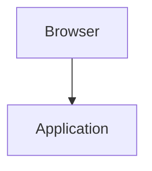

# Giovanni's blog

A small static blog built with Node.js. Articles are written in Markdown and
transformed into complete HTML pages during a build. An existing Node.js template engine
controls presentation. The generated `build/` directory is the deployable site,
with GitHub Pages as the intended host.

This README documents the implemented generator, its functional requirements,
and architecture.

## Getting started

Use Node.js 24 (`nvm use` if you use nvm), then run:

```sh
npm ci
npm test
npm run build
npm run preview
```

Open <http://localhost:8000>. Edit Markdown in `content/posts/` or
`content/pages/` and rebuild to see changes. `build/` is disposable output.
The included article and About page are starter content to replace.

Before publishing, set `origin` in `site.config.json` to your production origin
(currently `https://giovannifilardo.com`). Set `basePath` to your
repository path, such as `/my-blog`, or leave it empty for a domain-root site.
You can override these for a build using `SITE_ORIGIN` and `SITE_BASE_PATH`;
use the same `SITE_BASE_PATH` when previewing an overridden build.
`PORT` changes the preview port (default 8000).

To add a page, create a Markdown file with the metadata below. Add its logical
URL to `navigation` in `site.config.json` only if it should appear in the menu;
menu order follows the configuration. Articles automatically appear on the home
page and in their tag archives. Changing a title or filename preserves the URL
because the explicit slug controls the permalink. Keep published slugs stable;
redirect generation is not implemented.

For GitHub Pages, commit the source and lockfile, update the production settings,
and select **GitHub Actions** as the repository's Pages publishing source.
The included workflow validates pushes and pull requests and deploys successful
default-branch builds. No site has been published by this implementation.
For a custom domain, configure that domain and its DNS in GitHub Pages settings;
the `origin` setting controls generated URLs and does not configure hosting.

## Writing articles: tags and series

Both features are optional and live in each article's YAML front matter. There
is no separate tag dictionary or series configuration file.

- [Add readable tags](#add-readable-tags)
- [Group articles into a series](#group-articles-into-a-series)
- [Preview and release a draft part](#preview-and-release-a-draft-part)
- [Fix validation errors](#fix-validation-errors)

### Add readable tags

Add a `tags` list above the closing `---` in an article:

```yaml
tags:
  - Software_architecture
  - Domain-driven_design
  - API_design
```

| Value in YAML | Reader-facing label | Tag URL |
| --- | --- | --- |
| `Software_architecture` | Software architecture | `/tags/software-architecture/` |
| `Domain-driven_design` | Domain-driven design | `/tags/domain-driven-design/` |
| `API_design` | API design | `/tags/api-design/` |

Underscores become spaces in labels. Case and literal hyphens are preserved.
URLs use lowercase and convert underscores to hyphens. Labels appear consistently
in article lists, article metadata, topic lists, topic headings, and RSS categories.
URLs shown here are relative to the site root; configured `basePath` prefixes
are added automatically.

Use ASCII letters and digits, with single underscores or hyphens between words.
Do not use spaces, other punctuation, leading/trailing separators, or consecutive
separators. Existing lowercase tags keep their labels and URLs.

Reuse the **exact same spelling** in every article, including drafts. Identical
tags across articles are grouped together. Different spellings that produce the
same URL are build errors, including case differences such as `API_design` versus
`api_design`, and separator differences such as `API_design` versus `API-design`.
Duplicate tags within one article are also rejected.

Omit `tags` or use `tags: []` for an untagged article. Drafts do not create tag
archives or appear in them. Standalone pages may have tag metadata, but their tags
are not displayed and do not create article archives; conflict validation still
includes them. Renaming a tag can change its archive URL; redirects are not
created automatically.

### Group articles into a series

Create a normal Markdown article in `content/posts/`, with an additional `series`
block. For example, this is a complete first part:

```markdown
---
title: Start with the change, not the abstraction
slug: designing-for-change-1
date: "2026-10-23"
description: A useful boundary starts with understanding what changes—and why.
tags:
  - Software_architecture
series:
  id: designing-for-change
  title: Designing for change
  part: 1
draft: false
---
An abstraction is a prediction about what will change.

## Find a reason to change

Start with a concrete source of variation before introducing a new layer.
```

For the next articles, use different article titles, slugs, descriptions, and
bodies, but keep the same `series.id` and `series.title`. Change `series.part`
to the intended reading position:

| Article | `series.id` | `series.title` | `series.part` | `draft` |
| --- | --- | --- | --- | --- |
| First part | `designing-for-change` | `Designing for change` | `1` | `false` |
| Second part | `designing-for-change` | `Designing for change` | `2` | `false` |
| Upcoming third part | `designing-for-change` | `Designing for change` | `3` | `true` |

- `id` is a stable internal identifier: lowercase letters/digits separated by
  single hyphens. It groups the articles; it does not create a series URL.
- `title` is the reader-facing series name. It must be identical in every member
  article. To rename a series, update this title in all its members together.
- `part` is a unique positive integer within the series. Gaps are allowed; reading
  order follows these numbers, not publication dates or filenames.

A post can belong to one series. Omit the entire `series` block for a standalone
article. Series metadata is not supported on standalone pages in `content/pages/`.

Each published member gets a collapsible contents list, initially expanded,
near the top. The current article is marked “You're here.” Other published parts
are linked. Draft parts show their titles and part numbers as “Coming soon,”
without links. Previous/next links at the bottom skip drafts. There is no separate
series section or archive page, and articles still appear normally in the home
page, tag archives, and feed.

The repository includes a three-part example:

1. [Start with the change, not the abstraction](content/posts/designing-for-change-1.md)
2. [Make the contract explicit](content/posts/designing-for-change-2.md)
3. [Separate deployment when the boundary earns it](content/posts/designing-for-change-3.md) — draft

### Preview and release a draft part

Set `draft: true` on an upcoming article and assign its series and part number.
**This announces its title and position on published sibling articles.** Its body
is available at its preview URL, and it is excluded from public article indexes, tag archives,
RSS, and the sitemap. Keep a draft out of the series until its title is ready to
announce. An entirely draft series appears only in previews.

To check your changes locally:

```sh
npm run build
npm run preview
```

Open a published member, such as
<http://localhost:8000/posts/designing-for-change-1/>, to inspect the series list.
Use your configured port and base path if different. If the preview server is
already running, only rebuild and refresh; it does not rebuild automatically.

To release a part, change `draft: true` to `draft: false`, set `date` to the intended
publication date, and rebuild. The contents lists and previous/next links update
automatically. A future date alone does **not** keep an article unpublished; use
`draft: true` until it is ready. Building updates local output; publication follows
the repository's deployment workflow.

### Draft previews

`draft: true` is the only flag needed to preview an unfinished article. Draft
articles are generated at `/preview/<slug>/` and listed on the unlisted
`/preview/` page. These pages carry `noindex, nofollow` and cannot be added to
site navigation. Drafts stay out of the public home page, tag archives, RSS,
and sitemap; their tags do not create archives.

Public series lists show draft parts as unlinked “Coming soon” entries. Inside
a draft preview, series navigation can link to other draft previews and
published parts. Setting `draft: false` publishes the article at `/posts/<slug>/`
and removes its old preview page on the next build. The `/preview/` page slug
is reserved. Standalone page drafts remain excluded from output.

Preview pages are unlisted, not access-controlled: anyone with the URL can read
or share them. Search-engine directives are advisory. There is no `private`
flag; existing `private` metadata should be removed.

### Fix validation errors

| Error | How to fix it |
| --- | --- |
| Tags differ only by case or map to the same URL | Pick one exact spelling and use it in all affected files. The error names both spellings and source files. |
| A tag contains spaces or invalid separators | Use underscores for spaces; keep single hyphens only where the displayed label needs them. |
| Duplicate part number within a series | Give each member a unique positive integer, including draft members. |
| Series titles disagree | Use the identical display title in every article with that series ID. |
| Missing series field | Supply all three fields: `id`, `title`, and `part`, or remove the whole block. |

Errors stop the build and preserve the last successful `build/`. Validation
includes drafts, so publishing them later cannot introduce an unnoticed conflict.

Series grouping happens once after all articles are loaded. Articles share a
lightweight series list; their bodies are not copied or parsed again.

## Scope

The project uses Markdown posts and standalone pages, shared templates, copied
static assets, metadata, and a disposable output directory. All build and
development tooling runs on Node.js, with no Python dependency.

Rendering uses explicit template files and an existing Node.js template engine.
Articles have explicit metadata rather than dates embedded in filenames, and
generated pages use directory-based URLs. Analytics, external services, games,
image processing, and article-specific integrations are outside the initial scope.

The initial scope is a single-author blog: an article index, article pages,
standalone pages such as About, tag listings, an RSS feed, a sitemap, and a 404 page. Comments,
accounts, a CMS, server-side rendering, search, pagination, and live reload
are outside the initial scope. Readers need no JavaScript to read or navigate it.

## Functional requirements

| ID | Requirement | Acceptance criterion |
| --- | --- | --- |
| FR-01 | Author articles and standalone pages in Markdown with YAML front matter. | A valid source file produces an HTML page with its title and rendered body; headings, links, lists, images, fenced code, and tables work. |
| FR-02 | Validate content before publication. | Missing required fields, invalid calendar dates, unknown metadata keys, invalid slugs, and duplicate routes stop the build with source-specific diagnostics. |
| FR-03 | Exclude drafts from publication. | Draft articles render only under `/preview/`, with noindex/nofollow; standalone page drafts remain excluded. Draft titles explicitly assigned to a series appear only in that series’ contents list as “Coming soon”; drafts stay out of public indexes, feeds, and sitemaps. Future dates alone do not hide content. |
| FR-04 | Render shared layouts using an existing Node.js template engine. | Templates can interpolate escaped values, insert explicitly trusted HTML, branch on values, and iterate over collections; invalid syntax and missing required output values fail the build. |
| FR-05 | Generate a home page listing published articles newest first. | Each entry links to its article and shows title, publication date, and description. Equal dates sort by slug; zero articles produces a useful empty state. |
| FR-06 | Publish predictable URLs and navigation. | Articles use `/posts/<slug>/`, standalone pages use `/<slug>/`, and shared navigation links to the index and configured pages. |
| FR-07 | Include static files. | Contents of `static/` are copied unchanged into `build/`, preserving paths; local links and images resolve from both nested pages and the home page. Collisions with generated files fail the build. |
| FR-08 | Emit basic discovery metadata. | Pages contain a title, description, language, and canonical URL; published articles appear in valid RSS and sitemap XML. |
| FR-09 | Provide a repeatable local build and preview. | `npm run build` creates a complete `build/`; `npm run preview` serves it locally with directory URLs and a 404 fallback. Installed dependencies suffice for an offline build. |
| FR-10 | Support GitHub Pages deployment. | The same build supports a site at the domain root or under a repository path; the generated artifact contains `index.html`, `404.html`, and `.nojekyll`. |
| FR-11 | Fail safely and remove stale output on successful rebuilds. | Validation or rendering failure leaves the previous `build/` intact; success replaces it completely, removing deleted pages and obsolete publication/preview routes. |
| FR-12 | Produce readable, accessible static pages. | Layouts use semantic landmarks, one page-level heading, a skip link, visible keyboard focus, and responsive styling; navigation and article content work with JavaScript disabled. |
| FR-13 | Group articles by optional tags. | `/tags/` lists published article tags; `/tags/<tag>/` lists matching articles newest first. Changing tags does not change article URLs. |

## Source and output layout

Source layout (media paths illustrate where to add your own files):

```text
content/
  posts/hello-world.md
  pages/about.md
templates/
  layout.html
  post.html
  page.html
  index.html
  404.html
  tags.html
schemas/
  post.schema.json
  page.schema.json
static/
  assets/
    posts/
      hello-world/
        photo.jpg
    pages/
      about/
        portrait.jpg
  css/
    style.css
  js/
  favicon.ico
  robots.txt
site.config.json
src/
  build.mjs
  content.mjs
  template.mjs
  urls.mjs
  render.mjs
  series.mjs
  tags.mjs
  output.mjs
  preview.mjs
test/
package.json
package-lock.json
build/                    # Generated; ignored by version control
```

`static/` contains files copied unchanged into the output root. `static/assets/`
is reserved for media and downloads belonging to individual articles and pages,
organized by content kind and slug. For example, an article image at
`static/assets/posts/hello-world/photo.jpg` becomes
`build/assets/posts/hello-world/photo.jpg`. Site-wide styles, scripts, and fonts
live separately in `static/css/`, `static/js/`, and `static/fonts/` as needed.
Root-level files such as `static/favicon.ico` and
`static/robots.txt` become `build/favicon.ico` and `build/robots.txt`.
Copied files must not overwrite generated output; the route manifest checks both.
`.gitkeep` placeholders are ignored, and symbolic links are rejected.

Only Markdown files directly inside the two content directories are supported.
The required `slug` metadata controls the URL independently of the filename:
`hello-world` produces `/posts/hello-world/` for an article and `/hello-world/`
for a standalone page. Slugs must match `[a-z0-9]+(?:-[a-z0-9]+)*`.
Moving publication dates or renaming source files does not change article URLs.

Example article:

```markdown
---
title: Hello world
slug: hello-world
date: "2026-10-17"
description: Why I am starting this blog.
tags:
  - blogging
  - software
draft: false
---
My first article, written in **Markdown**.

## A first section

More text goes here.
```

`title`, `slug`, and `description` are required nonempty strings for all documents; `date`
is additionally required for articles. Dates use `YYYY-MM-DD` and are treated as
calendar dates in UTC. Optional `updated` must not precede `date`; optional
`draft` is a boolean, defaulting to false. Pages may omit dates. Unknown keys
are rejected to catch spelling errors. The template supplies the title as the
single `<h1>`; authored headings start at `##`. Raw HTML in Markdown is disabled.

Metadata is validated using the JSON schemas in `schemas/` with Ajv and
`ajv-formats`. Optional `tags` is a list of unique names using ASCII letters, digits, and single
hyphen or underscore separators, defaulting to an empty list. Case is preserved
for display, underscores become spaces, and literal hyphens stay hyphens. URLs
use lowercase names with underscores converted to hyphens. Published articles create `/tags/<tag>/` archives
and a `/tags/` index. Tags on standalone pages are accepted but do not create
article archives. Drafts contribute no pages or tag entries. Runtime defaults
are applied explicitly after schema validation.

## Architecture and requirement coverage

Use Node.js with ECMAScript modules and built-in filesystem, path, HTTP, and test
APIs. Node 24 is pinned in `.nvmrc` and CI; dependencies are locked in the npm lockfile. Use `markdown-it` for Markdown rendering
and `yaml` for front matter, with JSON Schema validation through Ajv. Use Nunjucks for templates rather than implementing a template language. These
are build dependencies; `template.mjs` only configures and wraps the engine. There is
no framework, application server, database, or browser runtime dependency.

### Build pipeline

1. **Read configuration.** Validate `site.config.json`: site title, author,
   description, language, production `origin`, `basePath`, navigation, and optional `copyrightYear`.
   `origin` is an HTTPS origin without a path; `basePath` is empty or a leading
   slash path without a trailing slash, such as `/my-blog`.
2. **Load content once (FR-01–03).** Parse metadata and Markdown into document
   objects containing source path, kind, slug, title, description, dates, draft
   status, logical URL, and rendered body. Validate all sources, including drafts,
   group series metadata (including draft titles), then filter drafts out of the publication collection.
3. **Plan outputs (FR-05–08).** Sort articles and construct a route manifest for
   the home page, documents, 404 page, assets, feed, sitemap, and `.nojekyll`.
   Reject collisions, including reserved page slugs such as `posts` and `assets`.
   Check configured navigation targets against the published route manifest.
4. **Render (FR-04, FR-08, FR-12–13).** Render content templates with
   explicit context objects and shared layout inheritance. Mark only rendered
   Markdown as trusted HTML. Generate RSS and sitemap using separate XML escaping,
   and collect generated output and static files in memory.
5. **Verify and publish output (FR-07, FR-09–11).** Check generated local link and
   asset targets against the manifest, ignoring external URLs and fragment-only
   references. After all checks pass, write a temporary sibling directory and
   replace `build/` with the staged output.
   Use a backup-and-rename sequence with rollback on replacement failure, then
   clean temporary directories. Log generated page counts and failures; failures
   return a nonzero process exit code.

`content.mjs` owns parsing and validation; `template.mjs` configures Nunjucks and passes rendering contexts; `urls.mjs` owns route and deployment URL rules; `render.mjs` owns
page contexts and XML rendering; `output.mjs` owns staging, asset copying, and
replacement. `build.mjs` orchestrates these modules. Keep content loading and build logic in JavaScript; templates receive explicit
data contexts and use shared layouts. Overlapping builds are rejected with a build
lock. The rollback sequence protects normal failures; it is not a guarantee of
atomic replacement across a machine crash.

Build order is stable. Identical sources, configuration, and locked dependencies
produce byte-identical output: dates come from content, ordering is explicit, and
no generated timestamp or current year is injected. Builds perform no network
requests after dependency installation.

### Template engine (FR-04)

Use [Nunjucks](https://mozilla.github.io/nunjucks/) for shared layouts, includes,
interpolation, conditionals, and loops. Adopt its existing syntax without defining
or maintaining a custom language, tokenizer, parser, or evaluator.

Configure a filesystem loader rooted at `templates/`, enable HTML autoescaping,
and enable errors for undefined output values. Validate required context fields
before rendering and report template errors as build failures. See the
[Nunjucks API documentation](https://mozilla.github.io/nunjucks/api.html) for
configuration behavior.

Mark only generator-rendered Markdown and rendered content fragments as safe
HTML; metadata remains escaped. URL preparation stays in `urls.mjs`, and RSS
and sitemap output use separate XML escaping. Templates are trusted repository
files, with no user-submitted template execution.

### URLs, assets, and GitHub Pages (FR-06–10)

Keep logical routes independent from deployment. For example, the logical route
`/posts/hello-world/` becomes `/my-blog/posts/hello-world/` when
`basePath` is `/my-blog`; its file remains
`build/posts/hello-world/index.html`. `urls.mjs` applies the prefix exactly once
and creates absolute canonical, RSS, and sitemap URLs using `origin`.

In Markdown and configuration, site-local links start with `/` and use logical
routes: `/about/`, `/posts/hello-world/`, and `/assets/posts/hello-world/photo.jpg`.
The Markdown renderer rewrites local link and image URLs through the same URL
helper. Relative file links such as `../about.md` are rejected initially to avoid
source/output ambiguity. External URLs retain their meaning.
Templates consume prepared URLs from their contexts.

#### Inline Mermaid diagrams

A fenced `mermaid` block is rendered to inline SVG at build time using
`beautiful-mermaid`. Optional text after `mermaid` becomes its accessible label
and caption. Flowcharts and sequence diagrams use the renderer's supported
Mermaid syntax; Mermaid plugins and browser integrations are not loaded.
No separate image files, browser JavaScript, or rendering service is needed.

````markdown

````

#### Images, layout hints, and legends

Images written as standalone Markdown blocks are transformed into semantic HTML5 `<figure class="image-figure ...">` enclosures with lazy loading (`loading="lazy"`):

```markdown

```

- **Legends / Captions**: The standard Markdown title attribute (`"Figure legend text"`) renders as `<figcaption>`, with support for inline Markdown (italics, bold, code, links). The redundant browser tooltip attribute on `` is stripped.
- **Layout hints via URL fragments**: Append `#fragment` to the image URL to map onto responsive CSS layout classes:
  - `#float-left` (`image-float-left`): Floats left (44% width); prose wraps right; resets to 100% full width on mobile (`<= 760px`).
  - `#float-right` (`image-float-right`): Floats right (44% width); prose wraps left; resets to 100% full width on mobile.
  - `#wide` (`image-wide`): Breaks out of the 730px prose column to align with the 1184px site shell.
  - `#bleed` or `#full` (`image-bleed`): Spans 100vw edge-to-edge across the screen while keeping the caption aligned with the prose column.
  - `#narrow` or `#center` (`image-narrow`): Capped at 380px centered for small UI dialogs and mobile screenshots.
- **Modifiers**: Combine with `+` (e.g. ``):
  - `#frame` or `#border`: Hairline `1px solid var(--line)` border and rounded corners for screenshots on light or dark paper.
  - `#invert-dark`: Inverts tones in dark mode (`filter: invert(0.9) hue-rotate(180deg)`) for transparent line art and SVGs.
  - `#pixelated`: Applies `image-rendering: pixelated` for retro graphics and pixel art.
- **Diagnostics**: Typos (e.g. `#flaot-right`), conflicting primary layouts (`#float-left+float-right`), or block layouts placed inline with text fail the build with helpful error messages. URL fragments are automatically stripped from the final `src` attribute.

Only article tags generate archives; each archive uses the same ordering as the home page.

RSS lives at `/feed.xml`; the sitemap at `/sitemap.xml`. Both include published
content only and use escaped absolute URLs. RSS article dates use UTC midnight;
sitemap modification dates use `updated`, falling back to `date` when present.
The root `404.html` uses deployment-aware links and asks crawlers not to index it.

The GitHub Actions workflow installs locked dependencies with `npm ci`,
runs tests and the build, then uploads **only `build/`** as the Pages artifact.
Pull requests validate without deploying; a successful build on the chosen
default branch deploys through the GitHub Pages environment. Grant deployment
permissions only to the deployment job and serialize deployments. Repository
Pages settings must select GitHub Actions before the first deployment. The workflow
follows the [GitHub Pages custom workflow model](https://docs.github.com/en/pages/getting-started-with-github-pages/using-custom-workflows-with-github-pages).

### Development and verification (FR-09, FR-11–12)

Commands:

```sh
npm ci
npm test
npm run build
npm run preview
```

Preview serves the existing `build/` on localhost, honoring `basePath`, directory
index files, MIME types, and the generated 404 page with a 404 status. It rejects
path traversal and does not expose source files. Rebuild manually after editing.

The checks use Node's test runner for template integration, escaping, and shared layouts, content validation,
draft exclusion, stable ordering, route collisions, and URL prefix handling.
Integration fixtures check full root and repository-path builds, XML
validity, missing assets, removal of stale pages, identical repeated output, and
preservation of the last successful build after failure. A local browser review
checks phone-width layout, keyboard focus, headings, and reading/navigation with
JavaScript disabled. Automated checks run with `npm test`. Browser review complements these checks.

If a process is forcibly terminated, remove `.build.lock` only after confirming no
build is running. Abandoned `.build-stage-*` directories can then be removed; if
a crash occurred during replacement, recover the previous output from a
`.build-backup-*` directory or rebuild.

## Planned improvements

- **Recursive content traversal for post partitioning**: Update `loadContent` in `src/content.mjs` to support recursive directory walking under `content/posts/`. This will allow organizing articles into ergonomic folders (e.g., `content/posts/2026/`, `content/posts/2025/`) as the archive grows, while keeping YAML front matter as the sole authoritative source of truth for publication dates, slugs, and permalinks.
- **Generalized interactive sketch and tool embeds**: Implement a generic embedding primitive using HTML `<object>` or sandboxed `<iframe>` elements to support both internal project sketches (e.g., HTML/Canvas/WebGL experiments authored inside the repository) and external embeds (e.g., CodePen, ShaderToy). Links with an `#embed` fragment or specialized directive can transform into responsive, styled enclosures with native fallback links.
- **Client-side static search (e.g., FlexSearch)**: Once the publication accumulates enough articles to warrant indexing, generate a lightweight search index manifest at build time and integrate a zero-dependency, client-side search solution like FlexSearch. This keeps full-text search instant, private, and deterministic without adding runtime server dependencies or third-party tracking services.
- **Deterministic geometric article identifiers (abstract generative sigils)**: Generate an abstract, code-driven geometric motif for each article, derived deterministically from its slug as a seed. A static build-time generator (e.g., in `src/motif.mjs`) will produce lightweight, un-animated inline SVG line work (concentric arcs, ruled coordinate grids, isometric projections, harmonic subdivision lattices) parameterized by the site's design tokens (`var(--ink)`, `var(--line)`, `var(--accent)`, `var(--muted)`). This acts as a digital ex-libris or architectural colophon positioned under the article title on reading pages, seamlessly adapting between Warm Alabaster and Velvet Bordeaux Noir while preserving the calm, uncluttered typographic ledger of the home page.

## Companion examples

Complete article examples live in the sibling [gf-blog-examples](../gf-blog-examples/README.md) repository, organized by article slug. The blog keeps short explanatory excerpts; example dependencies and tests run separately. To show a link below an article, add an optional `companion` URL to its front matter:

```yaml
companion: https://github.com/gfilardo/gf-blog-examples/tree/main/http-query-can-i-just-use-it
```

Use the article's example folder, which can contain more than one runnable example. The field accepts an absolute HTTPS URL. Omit it for articles without companion code. Published articles and draft previews use the same note; there is no separate boolean flag.
