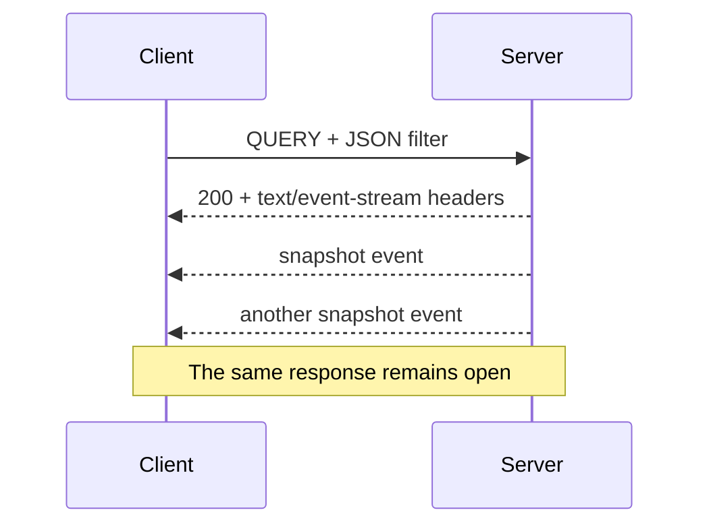
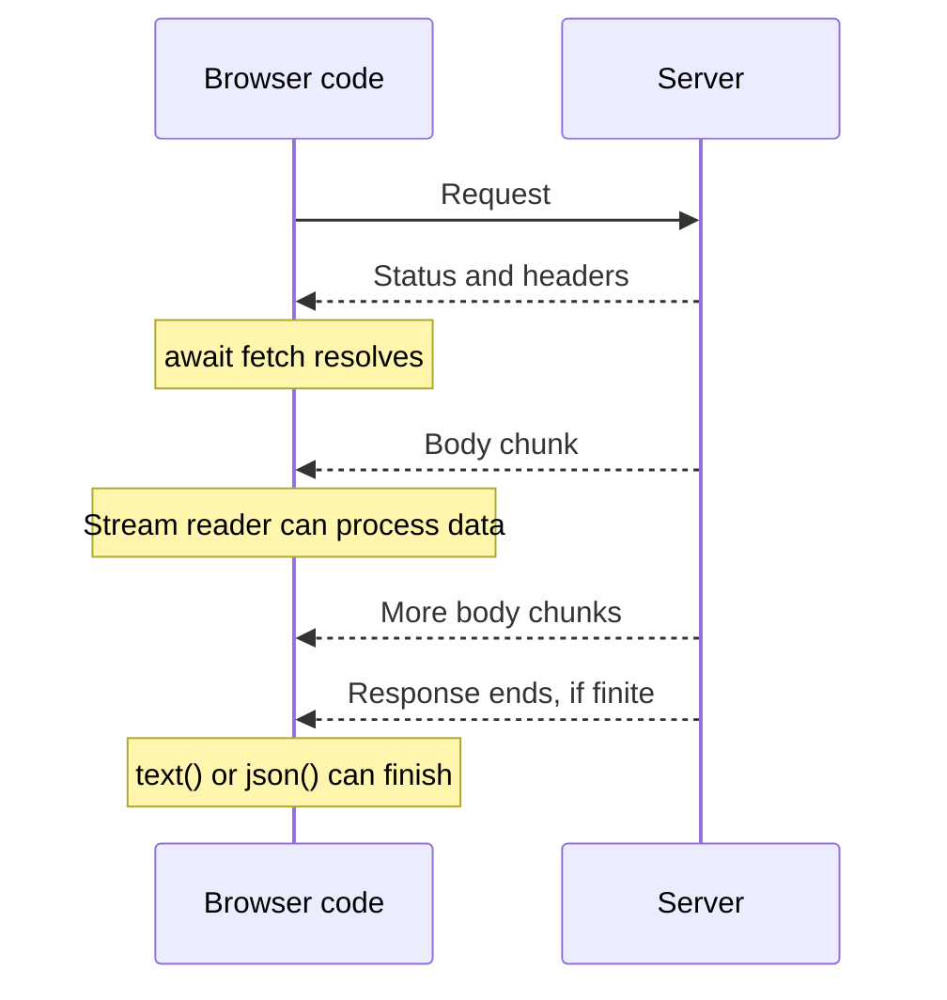

The first article gave us a search endpoint: a JSON filter goes in, matching results come back. Now imagine an operations dashboard for background jobs. An operator is watching imports for the warehouse project, filtered to running or failed jobs. While the page is open, one import finishes and another fails. A list fetched once no longer tells them what needs attention.

This is a useful place for live results. Completed jobs should leave the view; failed jobs should remain visible for investigation. A fuller dashboard might combine project, job type, status, owner, and submission time in its filter. The example below keeps just project and status so the streaming behavior stays easy to follow.


The dashboard above includes queued jobs too; our example uses a smaller running-or-failed selection.

Polling would be one answer. Another would be to keep the response open and send new results as they become available. Could the same `QUERY` request start that conversation?

[The first article](/posts/http-query-can-i-just-use-it/) followed a request through the stack to discover what “supports QUERY” actually means. Streaming gives us another version of that question. This time, the distinction begins inside the browser.

## SSE and EventSource are not quite the same thing

Server-sent events, or SSE, provide a text format for delivering events. EventSource is the browser API that makes receiving them convenient. They are closely associated, which makes it easy to assume that choosing one means choosing the other.

The native [EventSource interface](https://html.spec.whatwg.org/multipage/server-sent-events.html#the-eventsource-interface) starts a `GET` request. Its constructor accepts a URL and an option for credentials, but no method, request body, or arbitrary headers. So this cannot simply become our JSON-filtered `QUERY` request:

```js
// Native EventSource opens a GET request, with no filter body.
const events = new EventSource('/jobs/live');
```

That is a restriction of this API. It does not mean a server must reject every other method before returning an event stream.

The architectural inference is straightforward: a `QUERY` endpoint can return `text/event-stream`, provided the operation still honors its safe, idempotent contract. Keeping a read open does not inherently turn it into a write. Creating a durable subscription with its own lifecycle, billing, or externally visible state would be a separate operation to design, rather than something hidden inside the read.

Fetch gives us the method and body controls we need. What it does not give us is all of EventSource's behavior for free.

## One response, several events

An SSE response has a `Content-Type` of `text/event-stream`. A small event might look like this:

```text
event: snapshot
data: {"matches":[{"id":1,"project":"warehouse","status":"running"}]}

```

The blank line ends the event. The `event` field names its type; `data` carries text that our application happens to interpret as JSON. SSE itself does not require JSON.

The same endpoint can send the current matching jobs as its first event, then keep sending updates in that same response body. There is no need for a separate request to load the initial list and another to watch it. One request opens the response; the first snapshot populates the view; later events keep it current. Those later events can contain complete replacement snapshots or individual changes, according to the API contract.

The server is not sending another HTTP status line and another set of response headers each time. This snapshot-then-updates pattern works with either native EventSource over `GET` or our Fetch-based `QUERY` request. The server-side state problem is the same. EventSource supplies event parsing, automatic reconnection, and event-ID tracking; with Fetch, a parser and client logic provide those pieces. Neither automatically recovers missing application state.



There is also a distinction between an HTTP response and a network connection. Under HTTP/1.1, a long-running response occupies that connection while it is being delivered. HTTP/2 can carry [multiple concurrent streams on one connection](https://www.rfc-editor.org/rfc/rfc9113.html#section-5). Opening another event stream therefore does not necessarily mean opening another TCP connection. It still consumes resources at the browser, edge, and application.

## From a filter to a live view

The browser can open that response with a regular Fetch call:

```js
// The request carries the filter; the response carries SSE events.
const response = await fetch('/jobs/live', {
  method: 'QUERY',
  headers: { 'Content-Type': 'application/json', Accept: 'text/event-stream' },
  body: JSON.stringify({ project: 'warehouse', statuses: ['running', 'failed'] }),
});
```

Imagine two imports running. When one completes, it leaves the selection. When the other fails, it stays visible with its new status. Sending complete snapshots keeps the client simple: each one replaces the previous list.

The companion examples include a dashboard that receives full snapshots and a separate demonstration of reconnection and replay. The dashboard uses scripted snapshots to make the behavior easy to inspect; it is not a database change feed.

## Why do we await Fetch twice?

The familiar JSON request involves two separate `await`s:

```js
// First the headers, then the complete JSON body.
const response = await fetch('/jobs');
if (!response.ok) throw new Error(`HTTP ${response.status}`);
const jobs = await response.json();
```

The first `await` gives us a `Response` once the status and headers are available. It does not wait for the complete body, or even require the first body byte to have arrived. The second `await` reads the body to completion and parses it as JSON. `response.text()` also waits for the entire body, returning text instead.

That distinction is easy to overlook when a small response arrives almost immediately. With a live stream, it becomes the whole point: the headers are available, but the body may keep arriving for minutes or hours. Waiting for `response.text()` would accumulate that body until it ends; `response.json()` would additionally expect one JSON document, not SSE framing.

Instead, `response.body` lets us read progressively. Each read waits for another chunk, or the end of the stream. The companion server makes the separation visible by sending the headers before its first timed snapshot. A later disconnect can still fail a body read after Fetch has resolved.



## Bytes need decoding; text needs parsing

A Fetch response body arrives in chunks, but those chunks are not events. One chunk may contain several events, half a line, or part of a multibyte character. Calling `JSON.parse()` on each chunk would eventually fail, even if a local test happened to work.

There are two steps here. A [streaming text decoder](https://encoding.spec.whatwg.org/#interface-textdecoderstream) turns bytes into text without losing characters split across chunks. An SSE parser then turns text into complete events. Besides blank lines, the format has rules for multiline data, comments, and line endings. A parser is a better fit than a hurried `split('\n\n')`.

With a parser doing that work, the stream becomes a sequence of events our application can handle:

```js
// After checking the response, decode bytes and parse complete SSE events.
const events = response.body
  .pipeThrough(new TextDecoderStream())
  .pipeThrough(new EventSourceParserStream());
for await (const event of events) {
  if (event.event === 'snapshot') showJobs(JSON.parse(event.data).matches);
}
```

This is an excerpt: `EventSourceParserStream` comes from [eventsource-parser](https://github.com/rexxars/eventsource-parser), and `showJobs` represents replacing the displayed list. The companion example includes the imports, response checks, cancellation and completion handling. The parser turns text into events; it does not open requests or reconnect them.

## A caveat: reconnecting does not reconcile the view

Both EventSource and a Fetch-based client need an API that defines how the view stays consistent. EventSource reconnects automatically, but that alone does not recover missed changes. Two common patterns are:

- **Full snapshots:** each update replaces the displayed selection. Every new connection starts with a fresh snapshot, so reconnecting brings the view up to date without replaying intermediate changes.
- **A snapshot followed by changes:** the client builds its initial view, then applies additions, updates, and removals. After a disconnect, it needs either replay from a known position or a fresh snapshot that replaces its old state. The handoff between snapshot and changes must also avoid gaps.

EventSource remembers event IDs and can send `Last-Event-ID` when reconnecting. That is a resume hint, not a guarantee: the server must retain and replay the relevant changes, or provide a reset when it cannot. With Fetch, the client also owns the reconnection and cursor bookkeeping. Neither API reconciles application state on its own.

For this small dashboard, full snapshots are a reasonable starting point. The example sends complete selections, although its scripted sequence restarts on each request. A real endpoint would start each connection with the current matching jobs and send updated selections as they change. The screen needs an accurate current view; preserving every transition is a different requirement.

## A different request, the same streaming response

The response streams in the same way as it would after a GET request: the server sends the SSE text format over HTTP, and the infrastructure forwards it as it arrives. What changes is the request that starts it. QUERY lets us send the filter in its body; it does not introduce a different way of delivering the events.

The browser client does change. Native EventSource cannot initiate QUERY, so a Fetch-based client needs to provide the event parsing and reconnection behavior that EventSource normally supplies. The existing server-side streaming machinery can still be used.

The small caveat is that both capabilities must apply to the same route. A working GET event stream elsewhere does not guarantee that the QUERY route uses the same buffering and timeout settings. NGINX's [response buffering](https://nginx.org/en/docs/http/ngx_http_proxy_module.html#proxy_buffering), for example, can be configured per location. Once the request reaches the application and the response can flow back as events arrive, the existing streaming machinery is enough. These are the usual SSE deployment concerns, not a new set of requirements invented by QUERY.

## Would keeping EventSource be simpler?

Quite possibly. If the filter fits comfortably in a URL, native EventSource avoids writing much of the connection-management code. Its automatic reconnection is useful, although replay still requires server support.

For larger filters, an API could accept a POST that creates a saved query or subscription, then return a URL that EventSource opens with GET. That is a different design: the saved resource needs authorization, a lifetime, and perhaps deletion. It may be a good trade if browser convenience is more valuable than keeping everything in one request. The GET URL itself need not contain the original sensitive filter, but it still needs access controls.

Fetch plus QUERY is attractive when the input belongs in a body and the client already owns its stream lifecycle. It offers control over method, headers, cancellation, and reconnection. That control comes with work; a streaming parser is only one part of the client.

### Why SSE in 2026, when we have WebSockets?

For this job dashboard, the browser sends a filter and then mostly listens. SSE fits that shape: updates arrive in an ordinary HTTP response, while occasional actions can remain ordinary API requests. Notifications, job progress, and live dashboards often have the same pattern. There is no need to design a two-way messaging protocol just to keep a list current, although proxy buffering and timeouts still need attention.

Native EventSource also supplies parsing and automatic reconnection. Our Fetch-based QUERY version gives up that convenience, so it would be misleading to claim automatic reconnection as a benefit of this particular implementation. Event IDs help with resuming; they are not required merely to reconnect.

[WebSockets](https://websockets.spec.whatwg.org/) are a better fit when messages travel frequently in both directions, subscriptions change over the same channel, or binary messages are useful. SSE carries text events from server to client; changing our filter here means another request. Neither choice removes the need to define replay, authorization, or slow-consumer behavior. The reason to choose SSE in 2026 is still practical: sometimes a request followed by a stream of updates is all the application needs.

## What have we gained?

The original question was whether a body-based read could keep delivering results. It can, provided the server and the path support that exchange. The surprising obstacle is that the browser API usually associated with SSE cannot initiate our QUERY request.

Separating the pieces makes the choice easier to explain. QUERY describes the read. SSE describes the events in its response. Fetch gives the client access to that response. The application decides whether a disconnect calls for a fresh snapshot or a continuation of retained history.

For our job dashboard, a fresh filtered snapshot may be exactly what the screen needs. For an audit trail, it would be only the beginning of the design. The same transport can carry both; the promise to the reader is different.
