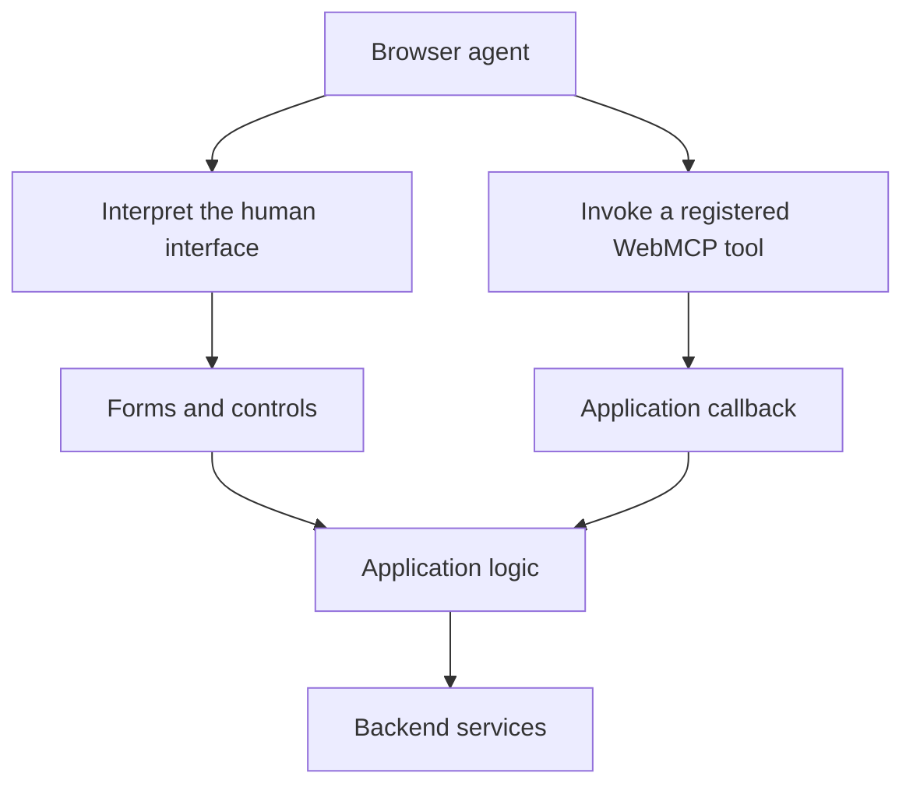

The web has an extraordinary distribution model. Send someone a link and they can open an application, sign in, and start working. Updates arrive without asking everyone to install a new release. The same platform serves documents, banking applications, design tools, and business systems.

That makes the browser an interesting place to look for the next stage of agentic computing.

We often discuss agents as something added to a product: a chat panel, a support assistant, a new way to search. WebMCP explores another direction. A website can expose capabilities that an agent can discover and invoke while working within the user’s browsing context.

The application becomes easier to operate through an assistant.

## From interpreting a screen to invoking a capability



Consider a ride-booking website. A human understands its interface through labels, maps, prices, and buttons. An agent operating that interface may have to interpret those elements and work out which sequence completes the task.

A structured tool offers another path. The website can describe a capability for obtaining a ride quote, declare its inputs, and provide an implementation that uses application logic. The draft’s [tool definition](https://webmachinelearning.github.io/webmcp/#dictdef-modelcontexttool) makes these pieces concrete: a name, a description, expected inputs and the application action to perform.

The interesting change is the relationship between the product and its operator. The product can explicitly describe what an agent can do, instead of relying entirely on the agent to infer that from a human interface.

This is what makes WebMCP worth an architect’s attention: it introduces another way to expose an existing web application’s behavior. The [WebMCP introduction](https://webmachinelearning.github.io/webmcp/#intro) describes tools implemented in client-side script and collaborative workflows within a shared interface.

## Where MCP fits
```mermaid Illustrative integration paths. WebMCP does not determine where the model runs.
flowchart TD
    A[Agent application] --> C[MCP client]
    C --> M[Local or remote MCP server]
    M --> S[Booking service]
    BA[Browser agent] --> W[WebMCP tools in an open page]
    W --> P[Web application logic]
    P --> S
```


The similar names invite confusion.

MCP provides a protocol through which AI applications connect to capabilities offered by servers, including tools and context. Those servers can be local or remote. The official [MCP architecture overview](https://modelcontextprotocol.io/docs/2026-07-28/learn/architecture) explains the host, client and server roles. WebMCP provides browser APIs through which a webpage exposes tools to agents.

In the ride example, an MCP integration could provide access to the booking service. A WebMCP implementation could expose capabilities through the website the user has open, using its current application context.

These approaches can complement each other. A service integration can support workflows that do not depend on an open webpage. A browser integration can support collaboration inside an existing web experience.

WebMCP is not a replacement for MCP or simply its JavaScript implementation. Chrome’s [comparison of WebMCP and MCP](https://developer.chrome.com/docs/ai/webmcp/compare-mcp) makes that distinction explicit.

## An application platform with another audience

The opportunity extends beyond reducing the number of clicks required to complete a task.

A user might ask an assistant to compare options, prepare a configuration, or explain a decision, then take over personally. The website remains a place where the user can inspect and change the work.

For product teams, this suggests a useful question: which capabilities would become more valuable if users could delegate part of the interaction?

The answer might be configuring a complicated product, preparing an expense claim, or finding a suitable booking. Each combines application state, user preferences, and decisions that may benefit from assistance.

This also changes the integration discussion. A company may need service-level access for some agent workflows and browser-level access for others. The choice should follow the user’s task and the context required to complete it.

## Enthusiasm with a clear boundary

WebMCP remains emerging technology. As checked on **30 October 2026**, the current specification is a Community Group draft, explicitly not a W3C Standard or a specification on the W3C Standards Track. Its evolution and implementation support deserve attention alongside its possibilities. See the [specification’s status](https://webmachinelearning.github.io/webmcp/#sotd).

It also says nothing by itself about where the model runs. A browser-based interaction can involve a remotely hosted model.

The architectural opportunity is nevertheless substantial. The web already distributes applications at enormous scale. Exposing their capabilities explicitly to agents could make those applications useful through a broader range of interactions.

A sensible experiment starts with one bounded workflow. Choose something users already find difficult, expose a small set of understandable capabilities, and observe whether assistance improves the outcome.

For leadership and product teams, viewing this transition purely as a new distribution channel conceals a significant trap. When an agent shortcut can reach the backend without passing through the visual journey, what happens to the disclosures, price checks, and approval gates carefully built into the human interface?

That question leads directly to the next article: how unaligned agent shortcuts can quietly produce unintentional dark patterns—and why this creates brand, regulatory, and architectural risks that leadership cannot afford to ignore.

## An accompanying example

A [working ride-booking example](https://github.com/gfilardo/gf-blog-examples) accompanies the series. It shows a person and an agent approaching the same booking through different interfaces. The repository’s README links to the example and explains how to run it; no real booking or payment takes place.

## References and further reading

- [WebMCP specification: introduction and status](https://webmachinelearning.github.io/webmcp/#intro) — the browser-tool model and its current maturity; check the status notice before treating the API as a settled standard.
- [MCP architecture overview](https://modelcontextprotocol.io/docs/2026-07-28/learn/architecture) — primary documentation for MCP participants, discovery and execution.
- [Chrome: When to use WebMCP and MCP](https://developer.chrome.com/docs/ai/webmcp/compare-mcp) — the architectural comparison, page lifecycle and existing application context.
- [WebMCP tool dictionary](https://webmachinelearning.github.io/webmcp/#dictdef-modelcontexttool) — the actual fields behind the description of structured capabilities.
- [Chrome: WebMCP tool security](https://developer.chrome.com/docs/ai/webmcp/secure-tools) — guidance to read before exposing a consequential workflow.

*Documentation checked on 30 October 2026. WebMCP is evolving; specification text, browser implementation and agent-host behavior should be checked separately.*
